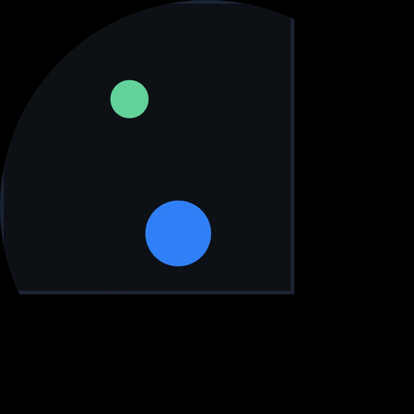
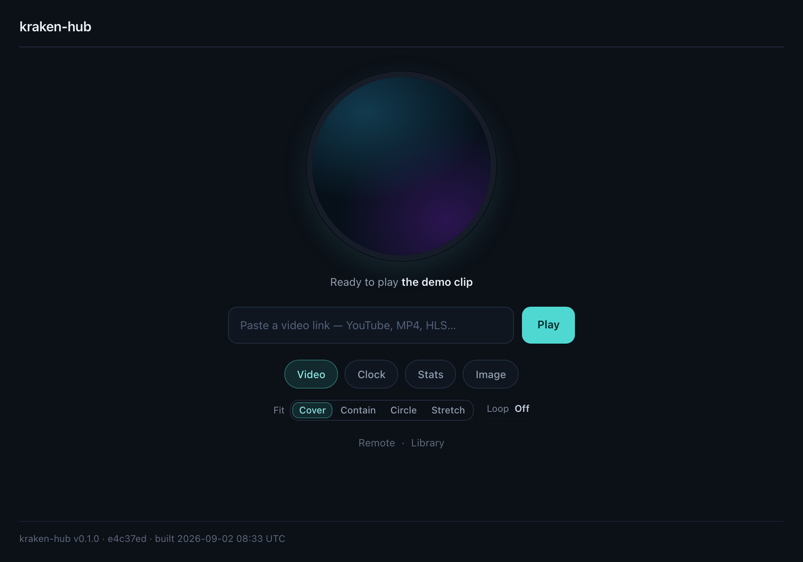
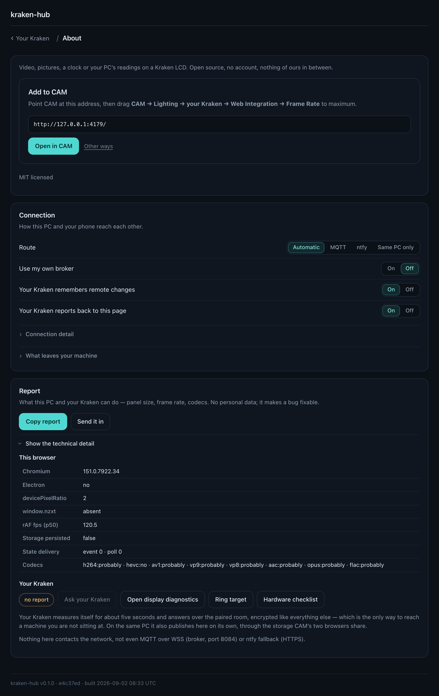
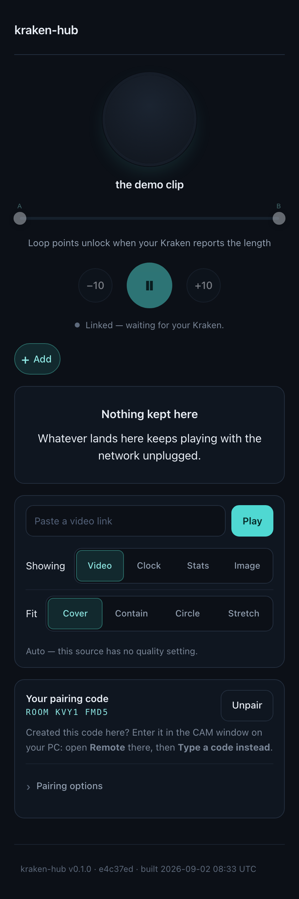

<div align="center">



# kraken-hub

**Real video, real modules, real control on your NZXT Kraken LCD.**

[](https://github.com/ubberkid/kraken-hub/actions/workflows/ci.yml)
[](LICENSE)
[](CONTRIBUTING.md)

[Getting started](docs/getting-started.md) · [Providers](docs/providers.md) · [Write a module](docs/modules.md) · [Troubleshooting](docs/troubleshooting.md) · [All docs](docs/README.md)

</div>

---

> [!NOTE]
>
> **Not published yet.** Every GitHub and Pages link on this page points at
> `ubberkid/kraken-hub`, which is not public yet — so the badges, the install
> links and the issue links will 404 until it is. Before that happens, work
> through **[docs/BEFORE-PUBLISHING.md](docs/BEFORE-PUBLISHING.md)** — it is the
> single list of every remaining GitHub setting, launch asset, and hardware claim
> still owed a measurement. Delete this note when that list is done.

## What it is

The NZXT Kraken Elite has a 640×640 round LCD, and CAM can point it at any web
page. The official YouTube integration takes that panel and embeds a 640×640
YouTube player in it — which makes YouTube serve about 360p — then scales it up
1.8× and crops. The player's spinner, watermark and pause overlay leak onto the
picture. It looks bad, and it looks bad for reasons that are fixable.

kraken-hub is the replacement. It is a statically hosted web app — no server, no
account, no telemetry — that:

- **plays video from almost any URL with no player chrome on the panel**, using a
  geometry trick that also gets YouTube to serve ~1080p instead of ~360p;
- **downloads the video into its own clip library and plays the local copy**, so
  playback is ad-free, offline-proof and seamless;
- **loops the exact section you care about**, with no visible seam;
- **is a hub, not a video player** — video, image/GIF, clock and stats are
  all modules, and adding a fifth is one directory and one line;
- **takes commands from your phone** — scan the code CAM is showing and the
  phone connects on its own, over an encrypted, backendless channel;
- **takes _files_ from your phone too** — a photo or a video goes from the camera
  roll straight to your Kraken over your own network, peer to peer, with nothing
  of ours in the middle, and lands in the same library a file dropped on the PC
  does ([how it works](docs/remote-control.md#add-from-your-phone));
- **is honest about what it cannot do**, in writing, with measurements.

---

> [!IMPORTANT]
>
> ### Do this first: raise the Frame Rate slider
>
> CAM ships the LCD Web Integration at **1 frame per second**. Skip this step and
> video is a slideshow — and that is CAM's slider, not this app.
>
> **CAM → Lighting → your Kraken → Web Integration → Frame Rate**
>
> | Device        | Slider maximum                                                                                                                                             |
> | ------------- | ---------------------------------------------------------------------------------------------------------------------------------------------------------- |
> | Kraken Elite  | 40                                                                                                                                                         |
> | Kraken (2023) | 25                                                                                                                                                         |
> | Kraken Z      | 1 — NZXT has stated this will not be raised                                                                                                                |
> | Kraken Plus   | ⚠ unmeasured, [H22](docs/hardware-checklist.md) — [send a hardware report](https://github.com/ubberkid/kraken-hub/issues/new?template=hardware_report.yml) |
>
> The Elite's capture pipeline also _compresses_ frames, so high-entropy
> full-screen video reaches fewer frames per second than the slider value. That
> mechanism — not resolution — is the other half of why video looks bad on these
> panels.
>
> **Measured, on one device:** with the slider at 40, the page's own render holds
> a locked 40 fps on a Kraken Elite (rAF p50 = p95 = 40, zero long frames; CAM
> 4.76.5 — [H12](docs/hardware-checklist.md#known-results)). So the app is not
> the bottleneck. What CAM then _captures_ and compresses is a different number,
> and it is still unmeasured —
> [H09–H11](docs/hardware-checklist.md) need a phone recording the panel at
> 60 fps, and nobody has done it yet.

## 60-second quickstart

**1. Raise the frame-rate slider.** ⬆ It is step one for a reason.

**2. Point CAM at kraken-hub.** Either use the hosted build:

> **[▶ Install into CAM](https://cam-redirect.nzxt.com/action/load-web-integration?url=https%3A%2F%2Fubberkid.github.io%2Fkraken-hub%2F)** ·
> [Install into CAM Beta](https://cam-beta-redirect.nzxt.com/action/load-web-integration?url=https%3A%2F%2Fubberkid.github.io%2Fkraken-hub%2F)

…or deploy your own fork, which takes about as long: **Fork → Settings → Pages →
Source: _GitHub Actions_ → push**. There is nothing to configure — the app
derives its own URL, storage namespace and embed origins from `location` at
runtime. [Self-hosting guide](docs/self-hosting.md).

Doing it by hand instead? **CAM → Lighting → your Kraken → Web Integration →
Edit → paste the URL → Apply → Add as Card.** Keep the **trailing slash**:
without it Pages answers with a redirect on every LCD boot.

**3. Press Configure on the card, and paste a link.** With no configuration at
all you already get a picture — a cold boot with no state plays a bundled demo
clip, offline. Then paste any video URL and kraken-hub downloads it.

Longer version, with the exact click path and screenshots:
**[docs/getting-started.md](docs/getting-started.md)**.

## Paste a link. It downloads it.

The headline feature is not a file picker. You paste a URL, and **kraken-hub
downloads the video into its own clip library and plays the local copy from then
on** — no CORS, no player chrome, no ads, real pause, seamless A‑B loop seams,
and it keeps playing with the network switched off.

- **Direct, CORS-reachable links** are fetched by the app itself, with a progress
  readout on the panel. No extra software.
- **YouTube** cannot be fetched by any browser page — [we measured it three
  independent ways](docs/why-not-extraction.md) — so it plays through a geometry
  trick that gets ~1080p and crops away every piece of player chrome. If you also
  run the [optional local companion](docs/resolver-protocol.md), YouTube links
  download into the same library and play like any other local clip.
- **A link the server refuses to hand over** streams instead, silently. You see
  your video either way.
- **Manual upload** still works, in CAM's configuration browser, as the fallback.

Because the Kraken Browser shares CAM's storage profile, the **display page
itself** performs the download — even when the URL came from your phone — with a
deliberately low-entropy progress card on the panel.

Full details in [docs/local-clips.md](docs/local-clips.md).

## Where video can come from

| Source                  | Quality control       | Loop seam              | Downloadable  | Notes                                                 |
| ----------------------- | --------------------- | ---------------------- | ------------- | ----------------------------------------------------- |
| **Local clip**          | your file             | seamless               | already local | The best path. Offline, no chrome, no ads.            |
| **Resolver companion**  | ✅ `maxHeight`        | seamless               | ✅            | Optional; downloads into the clip library.            |
| Direct `.mp4` / `.webm` | ❌ one rendition      | seamless once buffered | ✅ with CORS  | Downloaded and kept when the server allows it.        |
| HLS `.m3u8`             | ✅ per level          | within the buffer      | stream only   | Needs CORS — it is MSE. Live playlists don't loop.    |
| DASH `.mpd`             | ✅ per representation | within the buffer      | stream only   | Needs CORS. Live manifests don't loop.                |
| Reddit `v.redd.it`      | ✅ by ladder rung     | seamless               | ✅            | Probes the progressive ladder; usually skips dash.js. |
| YouTube                 | ⚠ indirect only       | measured at runtime    | via companion | Chrome-free, **not ad-free**. Aspect ratio is manual. |
| Twitch                  | ✅ real `setQuality`  | VOD/clip only          | ❌            | Live channels don't loop or seek.                     |
| Vimeo                   | ❌ uploader's tier    | ⚠                      | ❌            | An honest limitation, not a bug.                      |
| Streamable              | ❌                    | ❌                     | ❌            | No player API exists. It plays; nothing else.         |

Every row is chrome-free on the panel — that is what the geometry engine is for.
The per-provider version of this table, including exactly what fails and why, is
[docs/providers.md](docs/providers.md).

## Four modules

Everything on the panel is a module, including the video player. Adding a fifth
is one directory and one line in the registry —
[docs/modules.md](docs/modules.md) is the walkthrough, and the Clock module was
built by following it.

| Module    | What it does                                                                                                                                                               |
| --------- | -------------------------------------------------------------------------------------------------------------------------------------------------------------------------- |
| **Video** | Any of the sources above, downloaded and played locally, A‑B looped, chrome-free                                                                                           |
| **Image** | A picture or GIF from a link or your library — downloaded and painted from disk, with the video module's fit/zoom/pan/rotate math and an optional slideshow                |
| **Clock** | Digital or analog, 12/24-hour, optional seconds and date line, five flat colour themes. Deliberately correct at CAM's 1 FPS default: the hands tick, they never sweep      |
| **Stats** | CPU and GPU temperature and load plus liquid temperature, from CAM's 1 Hz feed. Single dial, dual dial or a compact grid. Anything CAM does not report reads `--`, never 0 |

There is **no pump-RPM readout**, because CAM exposes no such field. The stats
panel says so plainly rather than inventing a number.

## Optional: ad-free, full-quality YouTube

**[Download kraken-hub-resolver-win-x64.exe](https://github.com/ubberkid/kraken-hub/releases/latest/download/kraken-hub-resolver-win-x64.exe)** and double-click it.

That is the entire setup — one file, nothing to install, no Node required. The
first time you run it Windows SmartScreen will warn about an unrecognised app,
because the build is not code-signed: choose **More info → Run anyway**. Leave
the window open while you use it, or run it once with `--install-autostart` to
have it start at logon.

<details>
<summary>macOS, Linux, or building it yourself</summary>

The exe is the only prebuilt artifact. Everywhere else, run it from a clone:

```bash
npm install
npm run build:companion
node companion/resolver/dist/cli.js
```

(Publishing to npm may happen later; there is no `npx` install today.)

</details>

The companion is a small program that runs on your PC, binds `127.0.0.1` and
nothing else, and turns a pasted link into a plain video file the app can fetch.
kraken-hub finds it by itself — one silent health check —
and from then on a YouTube URL **downloads into your clip library and plays like
any other local clip**: no ads, no player chrome, full quality, real pause, a
seamless A‑B loop, and it keeps playing with the companion stopped and the
network unplugged.

It is optional in the strongest sense. With no companion running there is no
error, no banner and nothing to dismiss: YouTube falls back to the geometry
engine and everything else streams as usual.

**Before you install it, read what it means:** a running companion is a
machine-local capability granted to _every page in your browser_. It binds
loopback only, refuses `file:`, `data:` and private-network targets, is
rate-limited, is never a general proxy, verifies the yt-dlp binary's checksum,
and can be locked with `--token`. The full posture, and the reasoning, is in
[`companion/resolver/README.md`](companion/resolver/README.md) and
[docs/resolver-protocol.md](docs/resolver-protocol.md).

## Screenshots

Every image here is generated from the built app by `npm run capture` — nothing
is a mockup, and nothing is hand-cropped.

|                                                               |                                                                                     |
| ------------------------------------------------------------- | ----------------------------------------------------------------------------------- |
|             |                                       |
| The configuration UI, as CAM's Configuration Browser opens it | About & diagnostics — the way to get a report off a panel you cannot copy text from |



The phone remote, in a room whose Kraken has not spoken yet — so the card holds
the code rather than announcing a PC it has heard nothing from.
<sub>Captured with the offline `?transport=fake` transport, so building the docs
never touches a public broker.</sub>

## FAQ

**Does this remove YouTube ads?**
No, and nothing that renders a YouTube embed can. Ads play _inside the video
rect_, in the same pixels as the video; the geometry crop removes the player's
chrome, which lives on the letterbox bars outside the crop. The embed API exposes
no reliable ad signal either. If you want ad-free YouTube on the panel, run the
companion — it downloads the video to your machine and plays it as an ordinary
local clip. That is the honest answer, and it is why the documentation keeps
pointing there.

**Why not just extract the YouTube stream directly?**
Because it is not possible from a static origin, and we proved it three
independent ways rather than assuming: InnerTube returns 403 to any third-party
`Origin`; `googlevideo` sends no `Access-Control-Allow-Origin`, so MSE cannot
fetch the segments even with a valid URL; and the public Invidious/Piped networks
have collapsed — zero usable instances at the time of measurement, with the best
muxed format on offer being 360p. The measurements, with `curl` reproductions, are
in [docs/why-not-extraction.md](docs/why-not-extraction.md). It is the most useful
thing in this repository for anyone else building on this platform.

**Does audio work?**
Unknown, and the app says so rather than pretending. Whether CAM's webview
reaches your speakers at all is **[H08](docs/hardware-checklist.md)** — nobody has
measured it. Until somebody does, the display forces mute — and there is no
volume control anywhere in the app to suggest otherwise. A control that silently
does nothing is worse than no control at all.

**Does it work on a Kraken Z?**
Yes, but not for video. The Z is 320×320 and NZXT's CAM product manager has
stated its 1 FPS ceiling will not be raised, so anything that moves will be a
slideshow. The clock and stats modules are designed to be _correct_ at
1 FPS — nothing animates, every frame is a function of the current second — so
they are genuinely good on a Z.

**Does it work on a Kraken (2023)?**
Yes. 240×240, square, no round mask, slider maximum 25. Every module is checked
at that preset, and CI runs the layout tests at all four.

**Does it work on a Kraken Plus?**
Almost certainly, and it is the one row nobody can fill in: NZXT's documentation
predates the Plus and does not list its dimensions or shape. kraken-hub never
hardcodes them — it reads `window.nzxt.v1` — so it should simply work. If you own
one, [a hardware report](https://github.com/ubberkid/kraken-hub/issues/new?template=hardware_report.yml) closes
**[H22](docs/hardware-checklist.md)** and is the highest-value contribution
anyone can make right now.

**Is there a server? Does anything phone home?**
No, to both. The display page makes zero network requests until you give it a
source, and none at all when it is playing a local clip or the demo. The phone
remote is the only networked feature, it is optional, it uses a public broker
that relays ciphertext it cannot read, and both endpoints are user-overridable.
See [docs/remote-control.md](docs/remote-control.md) and
[SECURITY.md](SECURITY.md).

## Development

```bash
nvm use            # Node 22 (see .nvmrc)
npm ci
npm run dev        # http://localhost:5173/
npm run check      # typecheck, lint, invariants, format, unit tests, build, budgets
npm run test:e2e   # Playwright (chromium only)
npm run capture    # regenerate every screenshot in docs/assets/
```

### Developing without a Kraken

The app ships a hardware simulator, so every panel size, shape and frame rate is
reachable from an ordinary browser tab. Start `npm run dev`, then open:

| URL                                             | What it gives you                                                     |
| ----------------------------------------------- | --------------------------------------------------------------------- |
| `/`                                             | the configuration UI, exactly as CAM's browser sees it                |
| `/?kraken=1&sim=elite`                          | the display, as the LCD sees it: 640 round at 40 FPS                  |
| `/?kraken=1&sim=z`                              | Kraken Z — 320 round, and CAM's 1 FPS ceiling                         |
| `/?kraken=1&sim=kraken2023`                     | Kraken (2023) — 240 square, no round mask                             |
| `/?kraken=1&sim=elite&fps=1`                    | what a user who never touched the CAM slider actually sees            |
| `/?kraken=1&sim=elite&inject=late`              | CAM injecting `window.nzxt` 1.5 s after the page booted               |
| `/?kraken=1&sim=elite&monitor=missing`          | the 1 Hz feed with fields rotating in and out of `undefined`          |
| `/?kraken=1&sim=elite&module=clock&face=analog` | the Clock module's analog face                                        |
| `/?kraken=1&sim=elite&module=stats&layout=grid` | Stats in the compact grid layout                                      |
| `/?kraken=1&sim=elite&module=image&src=…`       | the Image module on a direct picture link                             |
| `/?kraken=1&sim=elite&diag=1`                   | the on-LCD diagnostics overlay (`&pattern=rings` for H20)             |
| `/#/library`                                    | your library: one grid of clips and pictures, plus the quota          |
| `/#/remote`                                     | the remote — and on a phone, every address resolves here              |
| `/#/about`                                      | About, Connection and Report — with every probe behind one disclosure |
| `/#/diag`                                       | resolves to `/#/about` — the two pages merged                         |

The simulator refuses to run whenever a real `window.nzxt` is present, so a
`?sim=` left in a configured URL is inert inside CAM.

## Documentation

**[docs/README.md](docs/README.md)** is the index, including a
[known gaps](docs/README.md#known-gaps) section listing what the design intended
and did not ship. The short version:

| Document                                         | What it covers                                                                        |
| ------------------------------------------------ | ------------------------------------------------------------------------------------- |
| [Getting started](docs/getting-started.md)       | CAM setup, the frame-rate slider, pasting a URL, pairing a phone                      |
| [Providers](docs/providers.md)                   | Every source, what works, and what does not — with reasons                            |
| [Local clips](docs/local-clips.md)               | Download-first ingestion, quota, persistence, the ffmpeg one-liner                    |
| [Why not extraction](docs/why-not-extraction.md) | The measurements that killed YouTube stream extraction, with curl repros              |
| [Modules](docs/modules.md)                       | Writing a module: the contract, the renderer, chunking, testing                       |
| [Resolver protocol](docs/resolver-protocol.md)   | The frozen v1 companion contract, and its security posture                            |
| [Remote control](docs/remote-control.md)         | Pairing, transports, failover, and the honest privacy model                           |
| [Troubleshooting](docs/troubleshooting.md)       | Symptom → mechanism → fix, each linked to the H-id that would settle it               |
| [Self-hosting](docs/self-hosting.md)             | Forking, Pages, custom domains, the no-hardcoded-origin table                         |
| [Hardware checklist](docs/hardware-checklist.md) | H01–H23: what is still unmeasured, and how to measure it                              |
| [Design docs](docs/design/)                      | The implementation-ready design, kept as authored, with corrections where reality won |

## Contributing

The single highest-value contribution is a
**[hardware report](https://github.com/ubberkid/kraken-hub/issues/new?template=hardware_report.yml)** — especially
from Kraken Plus and Kraken Z owners. Much of this design rests on documentation
plus one person's Kraken Elite, and every unverified claim is marked as such with
an H-id.

After that: a new module (the walkthrough is
[docs/modules.md](docs/modules.md)), a provider adapter, or a documentation fix.
[CONTRIBUTING.md](CONTRIBUTING.md) has the dev setup, the simulator flags, and
the eight platform invariants — each paired with the lint rule that enforces it,
because a constraint nobody can violate by accident is worth more than a
paragraph asking nicely.

## License

[MIT](LICENSE) © kraken-hub contributors.

## Disclaimer

kraken-hub is not affiliated with, endorsed by, or sponsored by NZXT, Inc.
"NZXT", "CAM", and "Kraken" are trademarks of NZXT, Inc.
