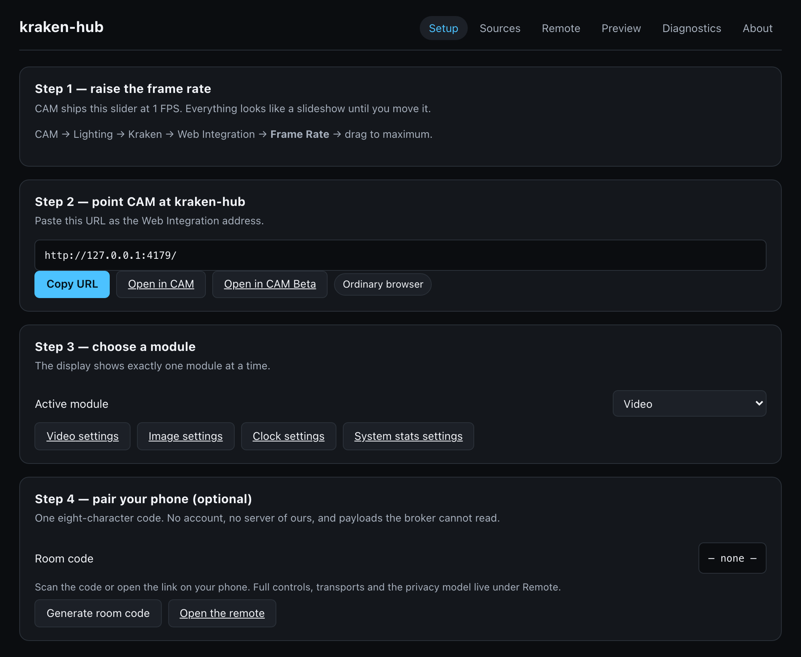
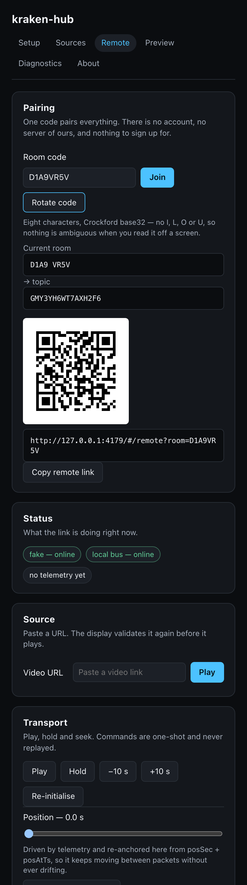

# Getting started

From a Kraken with nothing on it to a video playing on the panel. Ten minutes,
most of which is CAM.

**You need:** NZXT CAM **4.50.0 or newer** (the version that added the monitoring
feed), Windows, and a Kraken with an LCD — Elite, Kraken (2023), Kraken Z, or
Kraken Plus. You do not need an account, a server, or the companion.

---

## Step 1 — raise the frame rate slider

Do this **before** anything else, because everything after it will look broken if
you skip it.

**CAM → Lighting → your Kraken → Mode: _Web Integration_ → Frame Rate → drag to
maximum.**

CAM ships every Web Integration at **1 frame per second**. At 1 FPS a video is a
slideshow — one still image per second — and no web page can do anything about
it, because the slider governs how often CAM captures the page, not how fast the
page draws.

| Device        | Slider maximum                                                                 |
| ------------- | ------------------------------------------------------------------------------ |
| Kraken Elite  | 40                                                                             |
| Kraken (2023) | 25                                                                             |
| Kraken Z      | 1 — NZXT's CAM product manager has stated this will not be raised              |
| Kraken Plus   | ⚠ unmeasured ([H22](hardware-checklist.md)) — a hardware report would fix this |

Two things worth knowing once the slider is up:

- **The Elite compresses each captured frame**, so the frame rate you actually
  get depends on what is _in_ the frame. NZXT's own engineer put it plainly: "we
  use compression for the Elite, so the actual frame rate might vary depending on
  the frame content." Full-screen, high-entropy video — film grain, confetti,
  fast pans — is the worst case for that compressor. Flat colours and large
  simple shapes are the best. This is why kraken-hub's demo clip looks the way it
  does, and why a clock at 1 FPS looks perfect while a music video at 40 does
  not.
- **On a Kraken Z, kraken-hub is still worth running** — just not for video. The
  clock and system-stats modules are designed to be _correct_ at 1 FPS: nothing
  animates, every frame is a function of the current second.

## Step 2 — point CAM at kraken-hub

### The one-click way

**[▶ Install into CAM](https://cam-redirect.nzxt.com/action/load-web-integration?url=https%3A%2F%2Fubberkid.github.io%2Fkraken-hub%2F)**
· [Install into CAM Beta](https://cam-beta-redirect.nzxt.com/action/load-web-integration?url=https%3A%2F%2Fubberkid.github.io%2Fkraken-hub%2F)

That link hands CAM the URL and opens the Web Integration setup with it already
filled in. It is the same `cam-redirect.nzxt.com` deep link every listed
community integration uses.

### The manual way

**CAM → Lighting → your Kraken → Mode: _Web Integration_ → _Edit_ on the Custom
option → paste the URL → _Apply_.**

```
https://ubberkid.github.io/kraken-hub/
```

> [!WARNING]
>
> **Keep the trailing slash.** Without it, GitHub Pages answers
> `/kraken-hub?kraken=1` with a `301` to `/kraken-hub/?kraken=1`. A redirect on
> load probably works, but it is untested inside CAM, and it costs a round trip
> on every single LCD boot. Every copy button and every one-click link in
> kraken-hub emits the slash for exactly this reason.
>
> If you are running your own fork, the configuration page shows _your_ URL,
> derived from the address bar, with a copy button. Use that rather than typing
> one.

Then press **Add as Card**. The card is what makes the integration reusable, and
each card gets a **Configure** action — that button is what opens kraken-hub's
configuration UI.

### What just happened

CAM now runs kraken-hub in **two browsers on the same origin**:

- the **Configuration Browser** — the window _Configure_ opens, showing the setup
  UI you are about to use;
- the **Kraken Browser** — hidden, loaded with `?kraken=1`, captured frame by
  frame and streamed to the panel.

They share `localStorage` and IndexedDB, and that is the only channel between
them. It is why a change on the left appears on the panel without a reload, and
why a video you download in the configuration window is available to the display.

The Kraken Browser **never follows a navigation**. kraken-hub therefore has no
path router at all: every route is a hash, and the display page never navigates.



## Step 3 — put something on the panel

Open **Configure** on the card. With no configuration at all you already have a
picture: a cold boot with no stored state plays the bundled demo clip, offline,
with no network involved. That is the "is this thing on?" test.

### Play a video

**Sources → paste a URL.**

The headline behaviour is that kraken-hub **downloads the video into its own clip
library and plays the local copy from then on**. What happens next depends on
where the URL points:

| You paste                                             | What happens                                                                                                                                                                                              |
| ----------------------------------------------------- | --------------------------------------------------------------------------------------------------------------------------------------------------------------------------------------------------------- |
| A direct `.mp4` / `.webm` the server shares with CORS | The app fetches it into IndexedDB, with a progress readout on the panel, and plays it from disk.                                                                                                          |
| A direct link the server refuses to share             | It streams instead, silently. No error — you get your video either way, just not offline.                                                                                                                 |
| A YouTube link                                        | The geometry engine plays it at ~1080p with the player chrome cropped away. With the [companion](#step-5--optional-ad-free-full-quality-youtube) running, it downloads and plays as a local clip instead. |
| HLS, DASH, Reddit, Twitch, Vimeo, Streamable          | Each has its own adapter and its own honest limits — see [providers.md](providers.md).                                                                                                                    |
| Something that cannot work                            | The field says so before you commit, with the reason. `.mkv` gets the ffmpeg remux one-liner.                                                                                                             |

The full ingestion story, including manual upload, storage quota,
`navigator.storage.persist()`, and the square-crop ffmpeg one-liner, is in
[local-clips.md](local-clips.md).

### Or pick a different module

**Setup → Step 3 → Active module.** kraken-hub ships four: video, image/GIF,
clock and system stats. Each has its own settings page, and only the active one's
code is ever downloaded by the display.

### Preview it without a Kraken

**Preview** runs the real display page in a real iframe inside a bezel, at any
device preset and any frame rate. Set it to **1 FPS** to see exactly what a user
who never touched the CAM slider sees — it is the most useful thing on that page.

## Step 4 — pair your phone (optional)

**Setup → Step 4 → Generate room code**, then open **Remote** and scan the QR.



<sub>Captured with the offline `?transport=fake` transport, so building the docs
never touches a public broker. The layout is identical on a real one.</sub>

- The code is **eight characters of Crockford base32** — no I, L, O or U, so
  nothing is ambiguous read off a screen.
- The QR encodes a URL whose room code sits in the **fragment**, which browsers
  never send to a server. The QR is generated in your browser; nothing is
  uploaded to make it.
- Payloads are encrypted in the browser with a key derived from the room code,
  so the public broker relays ciphertext it cannot read. Anyone holding the code
  can drive your panel — treat it like a password and rotate it from the same
  panel if you ever share a screenshot.
- Transport failover (MQTT → ntfy) is automatic, and both endpoints are
  user-overridable if you would rather run your own.

The full threat model, the transports, and exactly what leaves your machine are
in [remote-control.md](remote-control.md).

## Step 5 — optional: ad-free, full-quality YouTube

```bash
npx kraken-hub-resolver
```

That is the whole setup. The companion is a small Node program that runs on your
own PC, binds `127.0.0.1` and nothing else, and turns a pasted link into a plain
video file the app can fetch. kraken-hub finds it by itself with one silent
health check; a YouTube URL then downloads into your clip library and plays like
any other local clip — no ads, no chrome, full quality, a real pause and a
seamless A‑B loop — and it keeps playing with the companion stopped.

With no companion running there is no error and no banner: YouTube quietly falls
back to the geometry engine.

**Before you install it, read what it means.** A running companion is a
machine-local capability granted to _every page in your browser_. Its posture —
loopback only, no `file:`/`data:`/private-network targets, rate limited, never a
general proxy, checksum-verified yt-dlp, `--token` if you want it locked — and
the reasoning behind each choice are in
[`companion/resolver/README.md`](../companion/resolver/README.md) and
[resolver-protocol.md](resolver-protocol.md).

---

## URL overrides

Anything on the display can be forced with a query parameter, which always wins
over stored settings and never persists. Useful for a second Kraken, a kiosk, or
a bug report you want somebody else to reproduce exactly.

| Parameter                                  | Effect                                             |
| ------------------------------------------ | -------------------------------------------------- |
| `module=video\|image\|clock\|stats`        | force the active module                            |
| `src=<url>`                                | force the source                                   |
| `fit=cover\|contain\|contain-circle\|fill` | force the framing                                  |
| `loop=<start>-<end>`                       | force an A‑B loop, in seconds                      |
| `room=<code>`                              | join a room without storing the code               |
| `demo=1`                                   | force demo mode                                    |
| `diag=1`                                   | draw the on-LCD diagnostics overlay                |
| `sim=elite\|plus\|z\|kraken2023`           | simulate a device (inert when CAM is really there) |

## Updating

Pages deploys continuously, so there is nothing to update: the next time CAM
loads the page you have the current build. To force it now, toggle the card off
and on in CAM. The version footer on every configuration page names the exact
build you are looking at — quote it in bug reports.

## Removing everything

Removing the card in CAM stops the panel but leaves the stored data alone.
kraken-hub keeps exactly two things on your machine, both in CAM's own browser
profile:

| What                               | Where                                                |
| ---------------------------------- | ---------------------------------------------------- |
| Settings, room code, telemetry     | `localStorage`, under keys prefixed `kraken-hub:v1:` |
| Clips, images and their thumbnails | IndexedDB, database `kraken-hub.v1`                  |

**Sources → Clip library → Delete** removes an individual clip and its bytes,
and the quota bar updates as it goes. There is not yet a single button that
wipes everything at once — clearing site data for the origin from a browser
pointed at the same URL does it. A one-click "reset all kraken-hub data" control
is a known gap, listed under [Known gaps](README.md#known-gaps).

## When it does not work

Start at [troubleshooting.md](troubleshooting.md) — blank panel, slideshow
playback, a clip that vanished, autoplay, a broker that will not connect, mixed
content and the companion going undetected are all in there, each with the
mechanism rather than a shrug.
